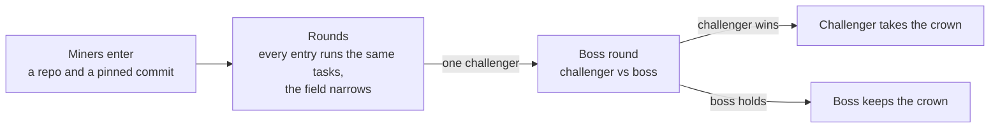

<h1 align="center">G.O.D</h1>

  Gradients on Demand: Bittensor subnet 56, where open-source training code competes in weekly tournaments for the subnet's emissions.

  <a href="docs/miner.md">Miner hub</a> ·
  <a href="docs/developer.md">Developer guide</a> ·
  <a href="https://gradients.io">gradients.io</a>

## How it works

Miners submit code, not compute. Each miner enters a tournament with a GitHub repository and a pinned commit. For every task the validator has trainers build and run that code on validator-managed GPUs, then evaluates and ranks the output.

Rounds narrow the field to one challenger. The challenger then meets the defending champion, the boss, in a boss round that decides the crown.

## Tournaments at a glance

| Tournament | Miners compete on | Guide |
| --- | --- | --- |
| Text | Code that trains language models | [Text guide](docs/miner_text.md) |
| Image | Code that trains image models | [Image guide](docs/miner_image.md) |
| Compression | Code that compresses language models | [Compression guide](docs/miner_compression.md) |

Schedule, fees and how to enter: [miner hub](docs/miner.md#tournaments).

## Quick start

### Miners

1. Write a training repository for one tournament and pin a commit.
2. Return it from `miner/endpoints/training_repo.py` and run the miner service.
3. Fund your coldkey balance with the entry fee.

Every step, with commands: [miner hub](docs/miner.md#what-miners-do).

### Validators

A validator needs Postgres, S3-compatible storage and a hotkey with subnet registration. From a fresh machine: [Running a validator](docs/developer.md#running-a-validator).

A trainer needs Docker with GPU support: [Running a trainer](docs/developer.md#running-a-trainer).

### Developers

Install, lint and test: [Setup](docs/developer.md#setup) and [Testing and linting](docs/developer.md#testing-and-linting).

## Documentation

| I want to... | Read |
| --- | --- |
| Enter a tournament | [Miner hub](docs/miner.md) |
| Know how the crown is decided | [The boss and the crown](docs/miner.md#the-boss-and-the-crown) |
| Know how emissions are paid | [Payouts](docs/miner.md#payouts) |
| See results and balances | [Results](docs/miner.md#results) |
| Run a validator or a trainer | [Developer guide](docs/developer.md) |
| Re-evaluate a task locally | [Evaluations and manual tools](docs/developer.md#evaluations-and-manual-tools) |
| Change this codebase | [Developer guide](docs/developer.md), [AGENTS.md](AGENTS.md), then the `README.md` in each module |
| Use the Gradients API | [SKILL.md](SKILL.md) |

## Licence

Apache 2.0. See [LICENSE.md](LICENSE.md) and [NOTICE](NOTICE).
