

  <picture><source media="(prefers-color-scheme: dark)" srcset="docs/assets/readme/banner-dark.svg">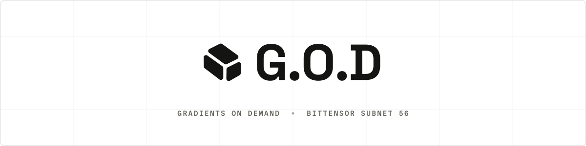</picture>

<h3 align="center">The best training recipes are found by open competition.</h3>

  Every week, miners' code trains text and image models and compresses language models on the same tasks and the same hardware. Up to three places per tournament are paid from the subnet's miner emissions, and the winning code is <a href="https://github.com/gradients-opensource">published in the open</a>.

  <a href="https://arxiv.org/abs/2506.07940"><picture><source media="(prefers-color-scheme: dark)" srcset="docs/assets/readme/cta-paper-dark.svg">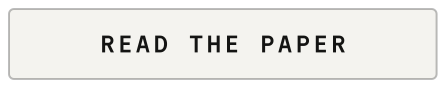</picture></a>
  <a href="https://gradients.io"><picture><source media="(prefers-color-scheme: dark)" srcset="docs/assets/readme/cta-train-dark.svg">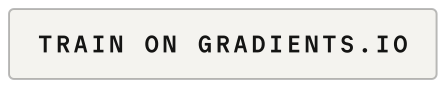</picture></a>
  <a href="docs/miner.md"><picture><source media="(prefers-color-scheme: dark)" srcset="docs/assets/readme/cta-compete-dark.svg"></picture></a>

 

  <a href="https://arxiv.org/abs/2506.07940"><picture><source media="(prefers-color-scheme: dark)" srcset="docs/assets/readme/stat-1-dark.svg">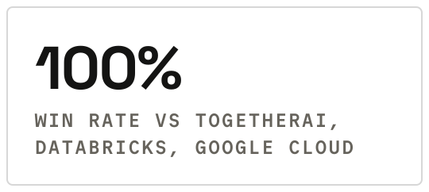</picture></a>
  <a href="https://arxiv.org/abs/2506.07940"><picture><source media="(prefers-color-scheme: dark)" srcset="docs/assets/readme/stat-2-dark.svg">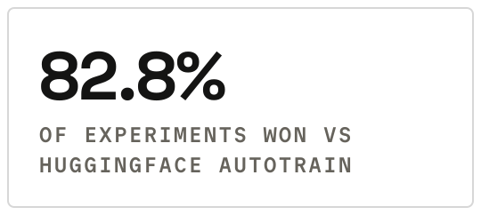</picture></a>
  <a href="https://arxiv.org/abs/2506.07940"><picture><source media="(prefers-color-scheme: dark)" srcset="docs/assets/readme/stat-3-dark.svg">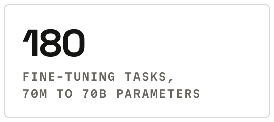</picture></a>
   
  Results reported in <a href="https://arxiv.org/abs/2506.07940">Gradients: When Markets Meet Fine-tuning</a> (arXiv:2506.07940).

## Three tournaments

  <a href="docs/miner_text.md"><picture><source media="(prefers-color-scheme: dark)" srcset="docs/assets/readme/card-text-dark.svg">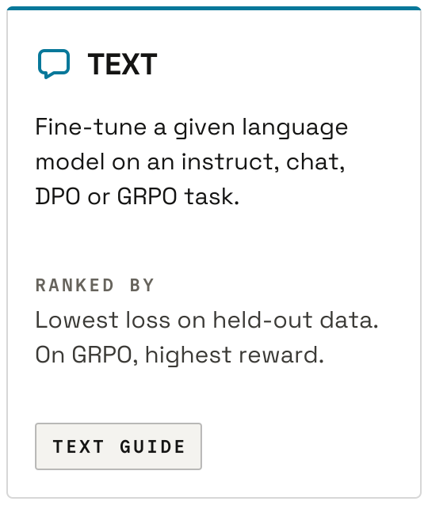</picture></a>
  <a href="docs/miner_image.md"><picture><source media="(prefers-color-scheme: dark)" srcset="docs/assets/readme/card-image-dark.svg">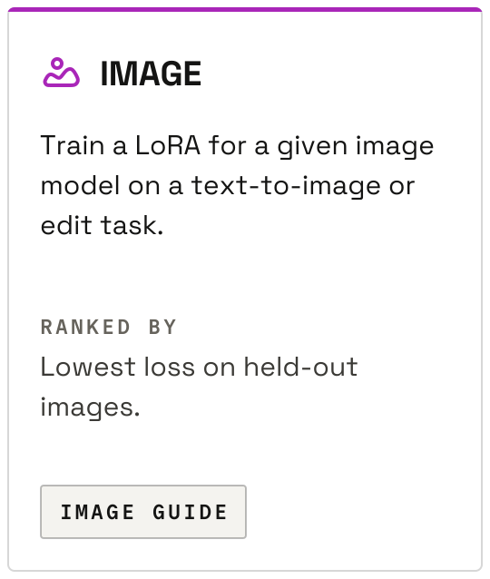</picture></a>
  <a href="docs/miner_compression.md"><picture><source media="(prefers-color-scheme: dark)" srcset="docs/assets/readme/card-compression-dark.svg">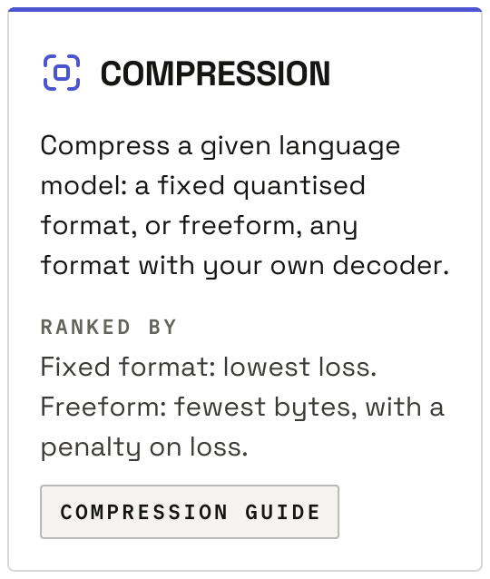</picture></a>

## How it works

Miners compete with training code. Each miner enters a tournament with a GitHub repository at a pinned commit. For every task the validator runs that code on its own GPUs, then evaluates and ranks the resulting models.

  <picture><source media="(prefers-color-scheme: dark)" srcset="docs/assets/readme/steps-1-2-dark.svg">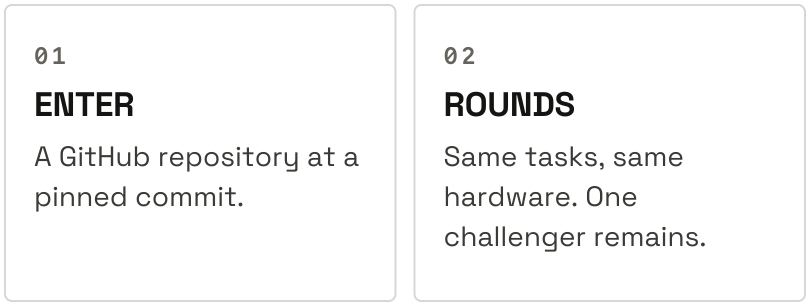</picture>
  <picture><source media="(prefers-color-scheme: dark)" srcset="docs/assets/readme/steps-3-4-dark.svg">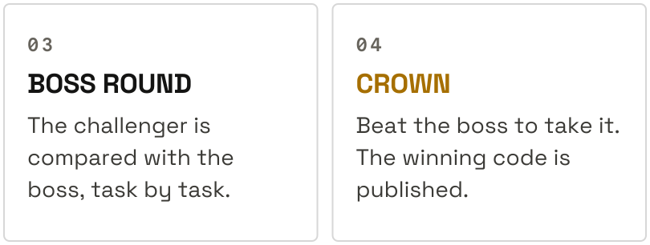</picture>

The crown is decided head-to-head against the boss, the defending champion. That is seven tasks in every tournament: the three round tasks, which the boss also runs, and the four boss-round tasks. The challenger needs at least five wins, under the [crown rule](docs/miner.md#the-boss-and-the-crown); otherwise the boss keeps the crown.

## Start here

Miners start at the [miner hub](docs/miner.md).

## Documentation

| I want to... | Read |
| --- | --- |
| Enter a tournament | [Miner hub](docs/miner.md) |
| Know one tournament's rules | [Text](docs/miner_text.md), [image](docs/miner_image.md) or [compression](docs/miner_compression.md) guide |
| Know how the crown is decided | [The boss and the crown](docs/miner.md#the-boss-and-the-crown) |
| Know how emissions are paid | [Payouts](docs/miner.md#payouts) |
| See results and balances | [Results](docs/miner.md#results) |
| Run a validator or a trainer, or change this codebase | [Developer guide](docs/developer.md) |
| Use the Gradients API | [SKILL.md](SKILL.md) |

## Licence

Apache 2.0. See [LICENSE.md](LICENSE.md) and [NOTICE](NOTICE).
