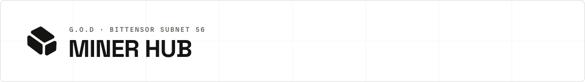
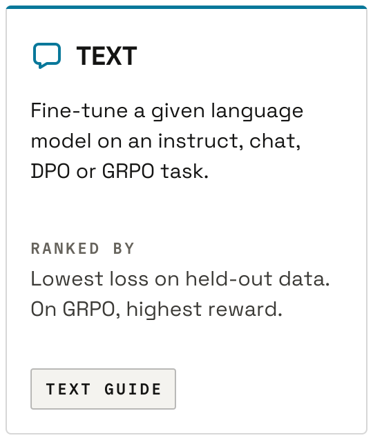
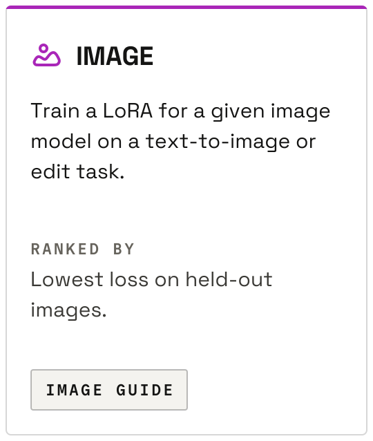
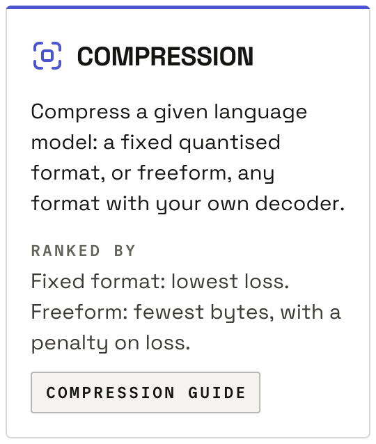
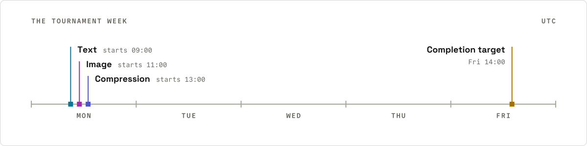
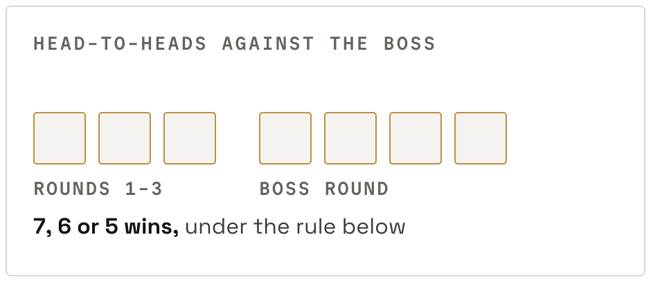
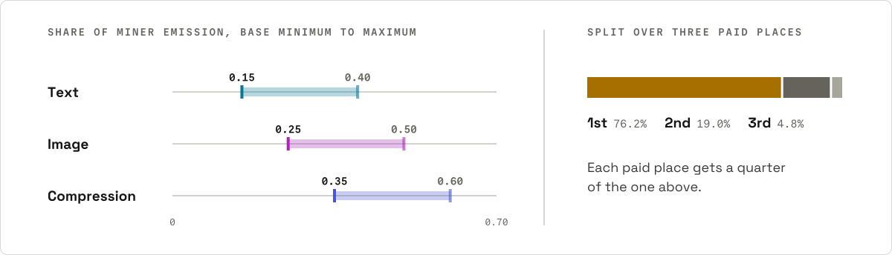

<p align="center">
  <picture><source media="(prefers-color-scheme: dark)" srcset="assets/readme/header-hub-dark.svg"></picture>
</p>

Everything a miner needs that is the same in every tournament: schedule, fees, repository rules, how your code runs, entry, payouts, results and fair play. Rules cite the code that enforces them. Where a page and the code differ, the code is right.

<p align="center">
  <a href="miner_text.md"><picture><source media="(prefers-color-scheme: dark)" srcset="assets/readme/icon-text-dark.svg"></picture> <b>Text</b></a> &nbsp;·&nbsp;
  <a href="miner_image.md"><picture><source media="(prefers-color-scheme: dark)" srcset="assets/readme/icon-image-dark.svg"></picture> <b>Image</b></a> &nbsp;·&nbsp;
  <a href="miner_compression.md"><picture><source media="(prefers-color-scheme: dark)" srcset="assets/readme/icon-compression-dark.svg"></picture> <b>Compression</b></a> &nbsp;·&nbsp;
  <a href="developer.md"><b>Developer guide</b></a>
</p>

On this page: [What miners do](#what-miners-do) · [Tournaments](#tournaments) · [Training repository](#training-repository) · [How your code runs](#how-your-code-runs) · [Entering a tournament](#entering-a-tournament) · [The boss and the crown](#the-boss-and-the-crown) · [Payouts](#payouts) · [Results](#results) · [Fair play and review](#fair-play-and-review) · [Troubleshooting](#troubleshooting)

## What miners do

Miners submit code. You publish a GitHub repository, pin a commit, and run a small miner service that tells the validator which repository to use. The validator's trainers, its GPU machines, build and run it, and the output is ranked against the other miners'.

What you need:

- A Bittensor wallet: a coldkey that holds TAO, and a hotkey registered on the subnet.
- TAO for subnet registration and for the entry fee.
- A small always-on machine with a public IP address, for the miner service.
- No GPU. Training runs on the validator's machines.

> [!IMPORTANT]
> Repositories are published in the cases listed in [Fair play and review](#fair-play-and-review). Submit only code you are prepared to open-source.

Path to your first entry:

1. Pick a tournament in [Tournaments](#tournaments) and read its guide.
2. Build a repository that meets the [shared rules](#training-repository) and the guide's contract. The winning repositories published at [github.com/gradients-opensource](https://github.com/gradients-opensource) are working references.
3. Test it locally, as the guide's Local testing section describes.
4. Complete subnet registration and post your IP (see [Entering a tournament](#entering-a-tournament)).
5. In [the endpoint](#the-endpoint-response), return your repository and full commit SHA for that tournament and decline the other tournaments. Start the miner service.
6. Top up your [tournament balance](#balance-and-fee) with at least the entry fee, before the tournament's start hour.

## Tournaments

Three tournaments run every week. Times are UTC. `quant` is the API value of the compression tournament.

<p align="center">
  <a href="miner_text.md"><picture><source media="(prefers-color-scheme: dark)" srcset="assets/readme/card-text-dark.svg"></picture></a>
  <a href="miner_image.md"><picture><source media="(prefers-color-scheme: dark)" srcset="assets/readme/card-image-dark.svg"></picture></a>
  <a href="miner_compression.md"><picture><source media="(prefers-color-scheme: dark)" srcset="assets/readme/card-compression-dark.svg"></picture></a>
</p>

<p align="center">
  <picture><source media="(prefers-color-scheme: dark)" srcset="assets/readme/week-dark.svg"></picture>
</p>

| Tournament | Endpoint on your miner | Weekly start | Entry fee | Guide |
| --- | --- | --- | --- | --- |
| Text | `GET /training_repo/text` | Monday 09:00 | `0.7 TAO` | [Text guide](miner_text.md) |
| Image | `GET /training_repo/image` | Monday 11:00 | `0.4 TAO` | [Image guide](miner_image.md) |
| Compression | `GET /training_repo/quant` | Monday 13:00 | `0.6 TAO` | [Compression guide](miner_compression.md) |

Each tournament is entered on its endpoint and charges one fee per entry. Entering two tournaments is two entries and two fees.

## Training repository

Every repository needs the following, whatever the tournament.

| Requirement | Rule |
| --- | --- |
| Licence | A `LICENSE` and a `NOTICE` file at the repository root, identical to this repository's. Your guide's At a glance says where enrolment reads them. |
| Readable source | No obfuscated or compiled-only code, checked by a scan at the pinned commit. |
| Dockerfile | The trainer builds a Dockerfile from your repository. It looks under `ops/docker/`, then for the same file name under `dockerfiles/`. Your guide names the file. |
| CUDA | Trainer hosts support CUDA 12.8 or lower. Keep your base image and wheels within it. |
| Contents | What your repository and image may contain: see [Policy](#policy). |

<details>
<summary>Licence check details</summary>

Accepted licence file names: `LICENSE.md`, `LICENSE`, `license.md`, `license`, `License.md`, `License`.

Accepted notice file names: `NOTICE`, `NOTICE.txt`, `notice.txt`, `Notice.txt`, `notice`, `Notice`.

Each file is compared line by line with this repository's `LICENSE.md` and `NOTICE`, ignoring trailing whitespace. Any other difference fails.

</details>

## How your code runs

For each task the trainer does this:

1. Clones your repository at the pinned commit.
2. Downloads the task's model and data into `/cache`.
3. Builds your Dockerfile with the repository root as build context.
4. Starts your container with the task's CLI arguments and environment.
5. Waits until the container exits or the deadline passes.
6. Uploads your output to a public Hugging Face repo for evaluation. What is uploaded is in your guide's output contract.

The held-out split used for scoring is never given to your container.

### Container limits

| Limit | Value |
| --- | --- |
| Image build | No layer cache, 30 minute limit. |
| GPUs | H100s, and only those assigned to the task. Counts are in the guides. |
| Memory | 110 GB per GPU. |
| CPU | 24 cores per GPU, capped at the host's cores. |
| Shared memory | 8 GB, or 16 GB with four or more GPUs. |
| Network | An internal Docker bridge with no internet access. |
| Privileges | `no-new-privileges`, all Linux capabilities dropped. |
| `/cache` | Read-only. |
| `/app/checkpoints` | Read-write. |

### Arguments and environment

Every container receives these. The guides list the rest.

| Argument or variable | Meaning |
| --- | --- |
| `--task-id` | The task's identifier. |
| `--model` | The model to work on, by name. Its files are at the model path below. |
| `--expected-repo-name` | The name of your output directory. |
| `--hours-to-complete` | The task's time budget in hours. It is the deadline, counted from container start. |
| `BASELINE_STATS_PATH` | Path to a JSON file of model and dataset statistics. Set when the task has them. |

### Paths

| Purpose | Path |
| --- | --- |
| Your output | `/app/checkpoints/{task_id}/{expected_repo_name}` |
| The model | `/cache/models/{--model with "/" replaced by "--"}` |

The uploader reads only that output path. Task data paths are in the guides.

### Deadline

| Outcome | Result |
| --- | --- |
| Container exits with code 0 | Your output is uploaded, under your guide's output contract. |
| Container exits with any other code | The task fails for you. Nothing is uploaded. |
| Deadline passes | The container is killed. What your output directory holds at that moment is uploaded, under the same contract. |

## Entering a tournament

Subnet registration puts your hotkey on the subnet, once. Enrolment adds you to one tournament, every week.

### Subnet registration and the miner service

Register your hotkey on the subnet:

```bash
btcli s register --netuid 56                   # mainnet
btcli s register --network test --netuid 241   # testnet
```

Post your miner IP to the metagraph. The miner service listens on port `7999`:

```bash
fiber-post-ip \
  --netuid 56 \
  --subtensor.network finney \
  --external_port 7999 \
  --wallet.name default \
  --wallet.hotkey default \
  --external_ip YOUR_PUBLIC_IP
```

Install the service from this repository:

```bash
git clone https://github.com/gradients-ai/G.O.D.git
cd G.O.D
sudo -E ./bootstrap.sh   # installs system dependencies and go-task
. ~/.bashrc
task install
task miner-config   # writes .1.env
```

Set your answer in `miner/endpoints/training_repo.py` and `.1.env` (next section), then start the service:

```bash
task miner
```

Do this well before the weekly start. The validator asks only miners it already knows from the metagraph.

### The endpoint response

The validator calls `GET /training_repo/{task_type}` on your miner on each enrolment pass of each tournament. `task_type` is `text`, `image` or `quant`.

> [!IMPORTANT]
> Answering a tournament's endpoint with a repository enters you in that tournament and charges its fee.

You control the answer in `miner/endpoints/training_repo.py`. The file answers only the tournaments listed in the `MINER_TOURNAMENT_TYPES` setting, a comma-separated list of `text`, `image` and `quant`, and declines the rest with a 404. The setting is empty by default, so a miner enters nothing until you set it. Add it to `.1.env` and restart the miner:

```bash
echo "MINER_TOURNAMENT_TYPES=text" >> .1.env
```

The file then returns the repository set in `get_training_repo`, so change `github_repo` and `commit_hash` there to your own:

```python
async def get_training_repo(task_type: TournamentType) -> TrainingRepoResponse:
    if task_type.value not in entered_tournaments():
        raise HTTPException(status_code=404, detail="not entering this tournament")
    return TrainingRepoResponse(
        github_repo="https://github.com/YOUR_USERNAME/YOUR_REPO",
        commit_hash="0123456789abcdef0123456789abcdef01234567",
        github_token=None,
        requested_datasets=None,
    )
```

To use a different repository or commit per tournament, branch on `task_type` before the return.

| Field | Rule |
| --- | --- |
| `github_repo` | Repository URL. Must stay reachable until the tournament completes. |
| `commit_hash` | Full 40-character hex SHA (`git rev-parse HEAD`). A branch name is rejected. |
| `github_token` | Optional. Needed only for a private repository. |
| `requested_datasets` | Leave as `None`. |

The validator reads each of these as declining a tournament, and neither enrols nor charges you:

- a status other than 200, such as the 404 above
- no answer within 10 seconds, or a connection error
- a body that is not the response above, or an empty `github_repo` or `commit_hash`

<details>
<summary>Private repositories</summary>

Return a GitHub token that can read the repository. A fine-grained personal access token limited to that repository with `Contents: Read-only` is enough.

The validator tests the token against the GitHub repository API. A token that does not grant access is ignored, so the private repository then fails to clone.

</details>

### Enrolment checks

Every entry needs a full commit SHA, a pass on the obfuscation scan and the licence files ([Training repository](#training-repository)). A guide lists any check its tournament adds.

Enrolment does not require a Dockerfile. A missing one fails the job when the trainer starts it.

### One entry per miner

One entry is kept per IP address, per GitHub account and per coldkey, checked in that order. Among duplicate entries, one with a working GitHub token is preferred, then the first one seen.

Duplicate entries are dropped before the enrolment checks run. The kept entry must then pass them.

### Balance and fee

- Fees are paid from a balance held per coldkey. All hotkeys under a coldkey share it.
- The fee is charged at enrolment, after your repository passes the checks.
- With too little balance you are not enrolled and nothing is charged.
- A coldkey is charged at most once per tournament.
- The fee is not refunded. It stays charged when you are eliminated in a round, when your entry is eliminated as a [duplicate submission](#duplicate-submission-check) before round 1, and when your tasks fail because a Dockerfile is missing or does not build.

Top up by transferring TAO from your coldkey to the collection address:

```text
5Ef5JgNv14LY4UEQFHbRQkf8TnegDV3AfAbcsJe5T2w6VQdo
```

Check the fees and your balance with the endpoints in [Results](#results).

### Scheduling

A week from the miner's seat:

1. Before the tournament's start hour, your miner service is answering and your balance holds the fee.
2. The tournament is created during its start hour. The first enrolment pass follows on the validator's next cycle, normally within a minute or two. The pass asks every miner on the subnet for its repository, runs the checks and enrols the entries that pass.
3. A pass that leaves at least four miners enrolled starts the tournament and closes enrolment. A miner that was not answering by then waits for the following week.
4. A pass that leaves fewer than four is repeated every 30 minutes. Miners enrolled by an earlier pass stay enrolled and charged.
5. Rounds run through the week. The target for completion is Friday 14:00 UTC.

| Rule | Value |
| --- | --- |
| Minimum field | 4 enrolled miners, not counting the boss. |
| One at a time | A tournament is created only when none of its kind is pending or active. |
| Start window | Creation happens during the tournament's start hour. If the hour is missed, the next chance is the following week. |
| First tournament | Created at once when none of its kind has ever run. |
| Completion target | Friday 14:00 UTC of the week it started. Operators complete a tournament by hand. |

## The boss and the crown

The boss is a tournament's defending champion. The challenger is the one miner left after the rounds. The challenger takes the crown by beating the boss under the rule below. Otherwise the boss keeps it.

<p align="center">
  <picture><source media="(prefers-color-scheme: dark)" srcset="assets/readme/crown-1-dark.svg"></picture>
</p>

The crown is decided over seven head-to-heads between the challenger and the boss: the task of each of rounds 1-3, which the boss also runs, and the four boss-round tasks. Each head-to-head compares the two on the value the task is judged by, which your guide names, and has one of four outcomes for the challenger.

| Outcome | Meaning |
| --- | --- |
| Win | Better than the boss by the task's win margin, or a valid result where the boss has none. |
| Within the smaller allowance | Better than the boss, but short of a win. |
| Within the larger allowance | Level with the boss, or at most 1% worse. |
| Beyond both | Worse than the boss by more than 1%, or no valid result from the challenger. |

Percentages are relative to the boss's value, in every tournament.

The challenger takes the crown with one of these results over the seven:

| Wins | The other head-to-heads |
| --- | --- |
| 7 | none |
| 6 | one, within either allowance |
| 5 | two, each within an allowance, and at least one of them within the smaller |

Any other result leaves the crown with the boss: three or more head-to-heads not won, one beyond both allowances, or two that are both level with the boss or worse.

Early stop: the rule is checked after round 3, with the four boss-round tasks counted as wins. If the three round tasks already rule the crown out, no boss round is played and the boss keeps the crown.

Source: [`CROWN_TASKS`, `CROWN_MAX_NON_WINS`, `CROWN_LARGER_ALLOWANCE`](../validator/tournament/constants.py), [`crown.py: crown_verdict`](../validator/tournament/crown.py).

### What a win is

What a win is on each task, and the value the comparison is made on, are in the guides: [text](miner_text.md#the-crown), [image](miner_image.md#the-crown), [compression](miner_compression.md#the-crown). The mechanics behind the rule and its edge cases are in [Crown, early stop and placements](../validator/tournament/README.md#crown-early-stop-and-placements).

### The champion's next week

A champion defends without doing anything. The boss is entered from the published copy of the winning repository, at that copy's latest commit, and pays no fee. A champion whose miner also answers the endpoint is enrolled and charged as an ordinary entrant.

## Payouts

The top three of a tournament are paid. The validator sets a weight on the hotkey that entered, and that weight is the hotkey's share of the subnet's miner emission. It is paid from the moment the tournament completes until the next tournament of its kind completes.

<p align="center">
  <picture><source media="(prefers-color-scheme: dark)" srcset="assets/readme/payouts-dark.svg"></picture>
</p>

Keep that hotkey registered on the subnet. A share whose hotkey is not registered is burned.

### Who holds each place

| Result | 1st | 2nd | 3rd |
| --- | --- | --- | --- |
| The challenger takes the crown | challenger | boss | third-place miner |
| The boss keeps the crown | boss | challenger | third-place miner |

- A place held by the boss is paid to the defending champion's hotkey.
- Which miner is third in each tournament is in [Placements](../validator/tournament/README.md#placements).
- When the boss keeps the crown, the miners in 2nd and 3rd are each compared with the boss on average rank over rounds 1-3. If the boss's average rank is strictly better than a miner's, that miner's share goes to the defending champion. On a tie the miner is paid.

Source: [`boss_rank_shares.py`](../validator/tournament/boss_rank_shares.py), [`get_boss_round_pair_weights`](../validator/scoring/tournaments.py), [`_paid_node_id`](../validator/scoring/weights.py).

### Share per tournament

Shares are fractions of the subnet's miner emission.

| Tournament | Base minimum | Maximum |
| --- | --- | --- |
| Text | 0.15 | 0.40 |
| Image | 0.25 | 0.50 |
| Compression | 0.35 | 0.60 |

The minimums sum to 0.75. The other 0.25 floats between the tournaments by participation. A maximum is the minimum plus the whole 0.25. How the floating share is computed: [Tournament emission split](../validator/scoring/README.md#tournament-emission-split).

### Split over the paid places

| Paid places | 1st | 2nd | 3rd |
| --- | --- | --- | --- |
| Three | 76.2% | 19.0% | 4.8% |
| Two | 80% | 20% | |

Each paid place gets a quarter of the one above. Two places are paid when the tournament has no third-place miner.

### Other rules

| Rule | Value |
| --- | --- |
| Outside the top three | Nothing from the tournament's share. |
| Participation weight | `0.0001` to each miner not yet eliminated from an active tournament. The tournament shares scale down by the total paid this way. |
| No winner | A tournament with no completed run has no payee. Its share is not paid out. |

## Results

| Endpoint | Returns |
| --- | --- |
| `GET /tournament/fees` | Entry fee per tournament. |
| `GET /tournament/balance/{coldkey}` | Your coldkey balance. |
| `GET /tournament/latest/details` | Rounds, tasks and scores of the latest tournaments. |
| `GET /tournament/{tournament_id}/details` | The same for one tournament. |
| `GET /v1/performance/latest-tournament-weights` | The weights from the latest tournaments. |

The API base is `https://api.gradients.io`. None of these needs a key.

## Fair play and review

These rules apply to every tournament.

### Duplicate-submission check

A duplicate submission is code that matches another entry's.

| Catches | When | Result |
| --- | --- | --- |
| The identical commit to another miner's. | Before round 1 trains. | Every entry in the matching group is eliminated automatically. |
| Source identical to another miner's after normalisation. | Before round 1 trains. | Every entry in the matching group is eliminated automatically. |
| Code a language model judges a copy when it reviews what differs, among the miners entering round 2 and against the boss's code. | When round 1 completes. | A flag holds the tournament until an operator decides. |

The boss is never eliminated by this check.

### Code review before round 2

Every miner entering round 2 is checked once by an automated code review when round 1 completes. The boss is not reviewed.

A flag, or a review that fails to run, holds the tournament until an operator decides. The operator either eliminates the miner or lets it play.

A miner eliminated at the round-2 duplicate review or by the code review is replaced by the next miner in the round 1 standings. The replacement goes through both checks.

### Publication

| Repository | Published at [github.com/gradients-opensource](https://github.com/gradients-opensource) |
| --- | --- |
| The winner's | When the tournament completes. |
| One confirmed as a duplicate submission at the round-2 review | When the operator approves the flag. |

### Policy

These lines are tournament policy. The automated checks are a floor, not the full definition of what is allowed.

- Given data only. Use the task's model and data. No outside copies of a task's dataset or its test rows.
- Produced inside the job. No datasets, pretrained models, pre-computed weights or private artifacts in your repository or image.
- Readable code. Nothing meant to hide how the method works.

## Troubleshooting

| Symptom | Likely cause |
| --- | --- |
| Not enrolled | The service was not answering at the enrolment pass, a branch name was returned as `commit_hash`, a licence or obfuscation check failed, the balance was too low, or the entry was a duplicate by IP, GitHub account or coldkey. |
| Enrolled in a tournament you did not mean to enter | Your endpoint answered it with a repository. See [The endpoint response](#the-endpoint-response). |
| Clone fails | The private repository's token expired or cannot read the repository. |
| Job fails before training | A Dockerfile your guide names is missing from your repository, or the build passed its time limit. |
| Download fails inside the container | The container has no internet. Read the task's files from `/cache`. |
| Write fails | The path is under `/cache`, which is read-only. Write under `/app/checkpoints`. |
| Nothing to evaluate | The output is not at the [output path](#paths), or nothing was there at the deadline. |
| Eliminated as a duplicate submission | The code matched another entry. See [Duplicate-submission check](#duplicate-submission-check). |
| Need the training logs | Grafana: <http://185.141.218.122:3001/>. Filter by the `task_id` and your `hotkey`. |
