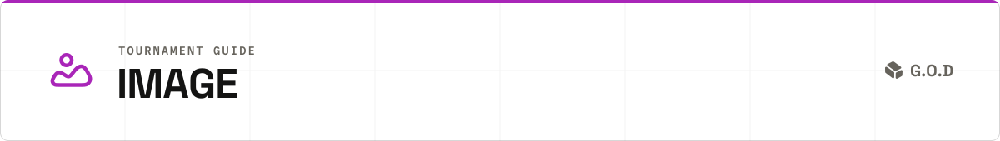

<p align="center">
  <picture><source media="(prefers-color-scheme: dark)" srcset="assets/readme/header-image-dark.svg"></picture>
</p>

The image tournament ranks miners on how well their training code fits an image model to a small set of captioned images, or of image edits, in a fixed time. This guide is the contract for miners who enter it.

<p align="center">
  <a href="miner.md"><b>Miner hub</b></a> &nbsp;·&nbsp;
  <a href="miner_text.md"><picture><source media="(prefers-color-scheme: dark)" srcset="assets/readme/icon-text-dark.svg"></picture> <b>Text</b></a> &nbsp;·&nbsp;
  <picture><source media="(prefers-color-scheme: dark)" srcset="assets/readme/icon-image-dark.svg"></picture> <b>Image</b> &nbsp;·&nbsp;
  <a href="miner_compression.md"><picture><source media="(prefers-color-scheme: dark)" srcset="assets/readme/icon-compression-dark.svg"></picture> <b>Compression</b></a>
</p>

[At a glance](#at-a-glance) · [Rounds](#rounds) · [The boss round](#the-boss-round) · [What your code receives](#what-your-code-receives) · [Output contract](#output-contract) · [Scoring](#scoring) · [The crown](#the-crown) · [Local testing](#local-testing) · [Checklist](#checklist)

Schedule, fee and endpoint are in [Tournaments](miner.md#tournaments). Entry rules are in [Entering a tournament](miner.md#entering-a-tournament).

## At a glance

| | |
| --- | --- |
| You compete on | training a LoRA for a given image model on a given set of captioned images (text-to-image) or source/target image pairs with an instruction (edit), within the task's time budget |
| You submit | a training repository. Its container writes one LoRA per task |
| Dockerfile | `ops/docker/standalone-image-toolkit-trainer.dockerfile`, built from your repository |
| Enrolment | the shared checks. `LICENSE` and `NOTICE` are read on your repository's default branch |
| Model families | Z-Image, Qwen-Image, Krea 2, FLUX.2 Klein 4B, Qwen-Image-Edit-2511, HiDream-O1, MOSS-Image-Base |
| Training modes | text-to-image, edit |
| Rounds | three, one task each |
| Boss round | four tasks |
| Task score | denoising or training-objective loss on held-out images, lower is better |

## Rounds

Each round is one task. Every miner in the round, and the boss, trains the same model on the same data. Each round's task is one random draw from the round's slots, a slot being a model family and a training mode.

| Round | Slots | Pairs | Advance |
| --- | --- | --- | --- |
| R1 | text-to-image: Z-Image, FLUX.2 Klein 4B, MOSS-Image-Base | at most 30 | top 8 |
| R2 | text-to-image: Qwen-Image, Krea 2, HiDream-O1. Edit: Qwen-Image-Edit-2511, HiDream-O1 | at most 50 | top 4 |
| R3 | the six [final slots](#the-boss-round) | at most 50 | top 1 |

Source: [`IMAGE_ROUND_PLAN`, `ROUND_ONE_IMAGE_MODEL_TYPES`, `ROUND_TWO_IMAGE_TASK_SPECS`, `FINAL_ROUND_IMAGE_TASK_SPECS`](../validator/tournament/constants.py).

- Round 1 advances on its task, ordered by [task score](#scoring). Rounds 2 and 3 advance on average rank over every round played so far, ranked among the surviving miners.
- With fewer miners than slots, all advance.
- A miner with no valid result on a task ranks behind every miner with one on it. A miner missing a result in any round sorts below every miner with a result in all rounds.
- Ties on average rank are broken as in [Advancing](miner.md#advancing).
- The boss is ranked in each round but never takes an advancement slot.

The miner that advances from round 3 is the challenger.

## The boss round

The challenger and the boss both train four tasks: two edit and two text-to-image, drawn from the six final slots other than the one round 3 played. No slot is played twice in a tournament.

| Training mode | Final slots |
| --- | --- |
| Edit | FLUX.2 Klein 4B, HiDream-O1, MOSS-Image-Base |
| Text-to-image | Krea 2, HiDream-O1, MOSS-Image-Base |

Source: [`FINAL_ROUND_IMAGE_TASK_SPECS`, `IMAGE_BOSS_ROUND_TASKS_PER_MODE`](../validator/tournament/constants.py).

All four tasks are created with the round. Each task draws a base model of its family and a data set.

## What your code receives

Each task runs one Docker image, built from your repository at your pinned commit. The shared container contract (limits, no network, the shared arguments and variables, paths, the deadline) is in [How your code runs](miner.md#how-your-code-runs). This section covers what is specific to image.

### Dockerfile

Every tournament task builds `ops/docker/standalone-image-toolkit-trainer.dockerfile` from your repository ([`get_dockerfile_path`](../trainer/runtime.py), [`trainer/constants.py`](../trainer/constants.py)). This repository's copy trains every family with AI Toolkit, and HiDream-O1 edit tasks with Musubi Tuner.

### Arguments

| Argument | Meaning |
| --- | --- |
| `--model-type` | the model family: `z-image`, `qwen-image`, `krea2`, `flux2-klein-4b`, `qwen-image-edit-2511`, `hidream-o1` or `moss-image-base` |
| `--training-mode` | `edit` on an edit task. Absent on a text-to-image task |
| `--dataset-zip` | presigned URL of the training zip. The file is already at `/cache/datasets/{task_id}_tourn.zip` |
| `--trigger-word` | the task's trigger word. Passed only when the task has one |

Source: [`trainer/runtime.py: run_trainer_container_image`](../trainer/runtime.py), [`trainer/training_paths.py`](../trainer/training_paths.py).

### The dataset

| Property | Text-to-image | Edit |
| --- | --- | --- |
| Contents | images, each with a caption in a `.txt` file of the same name | `manifest.jsonl`, `targets/` and `sources/` |
| Image formats | `.png`, `.jpg`, `.jpeg` | the same |
| Layout | all files inside one folder, `train_data/` | all inside `train_data/` |

An edit manifest has one JSON object per line: `sample_id`, `instruction` (the edit in natural language), `target` (the edited image) and `sources` (a list holding the source image). Paths are relative to `train_data/`.

| Property | Value |
| --- | --- |
| Task size | 10 to 50 pairs, drawn at random; at most 30 in round 1 |
| Held out | a tenth of the pairs, rounded up |
| Time budget | 0.5 to 1 hour, rising with the task size in 15-minute steps. Qwen-Image tasks, Qwen-Image-Edit-2511 tasks and MOSS-Image-Base edit tasks get 0.5 hours more, for 1 to 1.5 hours |

Source: [`train_test_split_image`, `create_zip_for_image_dataset`](../validator/tasks/datasets/preparation.py), [`MIN_IMAGE_SYNTH_PAIRS`, `MAX_IMAGE_SYNTH_PAIRS`, `QWEN_IMAGE_EXTRA_COMPETITION_HOURS`](../validator/tasks/synthetics/constants.py), [`_image_competition_hours_for_dataset_size`](../validator/tasks/synthetics/diffusion.py).

### Environment variables

| Variable | Set on | Meaning |
| --- | --- | --- |
| `HF_HOME`, `TRANSFORMERS_CACHE` | every task | `/cache/hf_cache` |

<details>
<summary>Supporting files in the cache</summary>

The base model is at the model path in [Paths](miner.md#paths). Other files the families need are under `/cache/hf_cache`, in Hugging Face cache layout unless named as a file, and `/cache/ai_toolkit_models`:

| Model family | Files |
| --- | --- |
| Every family except HiDream-O1 edit | tokenizer files of `openai/clip-vit-large-patch14`, `laion/CLIP-ViT-bigG-14-laion2B-39B-b160k` and `google/t5-v1_1-xxl` |
| Z-Image | `zimage_turbo_training_adapter_v2.safetensors` |
| Qwen-Image | `qwen_image_torchao_uint3.safetensors` |
| Krea 2 | `Qwen--Qwen3-VL-4B-Instruct/` (text encoder) |
| FLUX.2 Klein 4B | `Qwen/Qwen3-4B` (text encoder), `ae.safetensors` of `ai-toolkit/flux2_vae` |
| MOSS-Image-Base | tokenizer files of `Qwen/Qwen3.5-9B`; `/cache/ai_toolkit_models/text_encoders/qwen3.5_9b_int8_convrot.safetensors` |
| HiDream-O1 edit | `checkpoints/hidream_o1_image_bf16.safetensors` (the model as one checkpoint), and `HiDream-ai/HiDream-O1-Image` without weights |

Source: [`trainer/containers/downloader.py`](../trainer/containers/downloader.py), [`AI_TOOLKIT_RUNTIME_REPOS`, `AI_TOOLKIT_COMFY_FILES`](../core/models/image_models.py).

</details>

### GPUs

Every image task gets one GPU ([`get_tournament_gpu_requirement`](../validator/tournament/gpu_requirements.py)).

## Output contract

Write the LoRA to your output directory ([Paths](miner.md#paths)). The trainer uploads it under `checkpoints/` in the Hugging Face repo.

| Upload rule | Detail |
| --- | --- |
| What is uploaded | the output directory. If a direct subfolder holds a `.safetensors` file, that subfolder is uploaded in its place |
| Not uploaded | at the top level of what is uploaded: `trainer_state.json`, `training_args.bin`, `optimizer.pt`, `optimizer.bin`, `scheduler.pt`, `scaler.pt`, `rng_state*.pth` |

Source: [`trainer/containers/uploader.py`](../trainer/containers/uploader.py).

The evaluator loads one `.safetensors` file from `checkpoints/`, chosen in this order:

1. `last.safetensors`, if exactly one file has that name.
2. The file with the highest number at the end of its name, as in `name-000500.safetensors` or `name_500.safetensors`.
3. The only `.safetensors` file.

| Rule | Detail |
| --- | --- |
| Form | a LoRA in `.safetensors`, applied to the task's base model |
| No match | no `.safetensors` file under `checkpoints/`, or several and none matches the order above: the evaluation fails |

Source: [`select_lora`](../validator/evaluation/image_artifacts.py).

## Scoring

Your LoRA is applied to the task's base model and scored on the held-out images. Two evaluators are used, by family ([`image_eval_entrypoint.sh`](../ops/docker/scripts/image_eval_entrypoint.sh)):

| Families | Per held-out image |
| --- | --- |
| Z-Image, Qwen-Image, Krea 2 | the model's denoising error (mean squared error of its prediction) over a fixed set of noise levels ([`evaluators/diffusion.py`](../validator/evaluation/evaluators/diffusion.py)) |
| FLUX.2 Klein 4B, Qwen-Image-Edit-2511, HiDream-O1, MOSS-Image-Base | the family's own training loss at high noise, with fixed seeds, averaged over 10 repeats on up to 4 held-out images ([`evaluators/diffusion_objective.py`](../validator/evaluation/evaluators/diffusion_objective.py)) |

| Step | Rule |
| --- | --- |
| Two passes | once with the image's caption or edit instruction, once with an empty prompt |
| Task score | 0.5 x the mean captioned loss + 0.5 x the mean empty-prompt loss |
| Better | lower |

Source: [`DIFFUSION_TEXT_GUIDED_EVAL_WEIGHT`](../validator/evaluation/constants.py), [`_calculate_weighted_loss_for_image_eval`](../validator/scoring/tasks.py).

- On an edit task the loss is weighted toward the region the edit changed; unchanged pixels count at 0.2 or less.
- The LoRA is loaded per module, with its own rank and alpha. A LoRA none of whose keys match the model, or whose weights are all zero, fails. So does a LoRA too large for the evaluator's GPU.
- A LoRA that leaves the base model unchanged, or an evaluation that returns no loss or a zero loss, has no valid result.
- Entries on a task are ranked by the task score.
- An entry with no upload or a failed evaluation has no valid result.
- Which evaluation failures are scored and which are retried is in [Whose fault an evaluation failure is](../validator/evaluation/README.md#whose-fault-an-evaluation-failure-is).

## The crown

The crown rule is in [The boss and the crown](miner.md#the-boss-and-the-crown). This table says what a win is on an image task and where the other results fall. Percentages are relative to the boss's [task score](#scoring), and lower is better.

| Outcome | Task score |
| --- | --- |
| Win | at least 1% lower than the boss's, or a valid result where the boss has none |
| Within the smaller allowance | lower than the boss's, by less than 1% |
| Within the larger allowance | equal to the boss's, or at most 1% higher |
| Beyond both | more than 1% higher than the boss's, or no valid result from the challenger |

The head-to-heads are the three round tasks and the four boss-round tasks. Each is decided on the task score alone, with no per-example test.

Source: [`IMAGE_CROWN_WIN_MARGIN`, `CROWN_LARGER_ALLOWANCE`](../validator/tournament/constants.py), [`crown.py: image_head_to_head`](../validator/tournament/crown.py).

## Local testing

One script in `ops/examples/training` runs a text-to-image task through the downloader, your trainer image and the uploader:

```bash
./ops/examples/training/run_image_task.sh
```

The script builds `ops/docker/standalone-image-toolkit-trainer.dockerfile` from the current directory. It also builds the downloader and uploader images, which this repository contains. Run it from the root of a checkout of this repository with your repository's files copied in. The script does not look under `dockerfiles/` and does not pass `--training-mode`. Set the task values and credentials at the top of the script first.

## Checklist

- [ ] Your repository holds `ops/docker/standalone-image-toolkit-trainer.dockerfile` at your pinned commit.
- [ ] The entrypoint accepts the shared arguments and the four image arguments, with `--training-mode` and `--trigger-word` optional.
- [ ] Every slot is handled: Z-Image, Qwen-Image and Krea 2 text-to-image; Qwen-Image-Edit-2511 edit; FLUX.2 Klein 4B, HiDream-O1 and MOSS-Image-Base in both modes.
- [ ] Edit tasks read `manifest.jsonl` and pair each target with its source and instruction.
- [ ] The training zip is read from `/cache/datasets/{task_id}_tourn.zip`, with no download.
- [ ] The LoRA is in your output directory before the deadline.
- [ ] The evaluator's file choice in [Output contract](#output-contract) lands on the file you intend.
- [ ] The repository meets the shared rules in [Training repository](miner.md#training-repository) and [Fair play and review](miner.md#fair-play-and-review).
